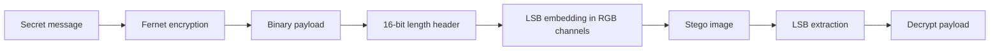

# Image Steganography

An educational image-steganography application that hides a symmetrically encrypted message inside an image while preserving its visible appearance.

[Open the interactive notebook in Colab](https://colab.research.google.com/github/tawan-chaidee/Image-Steganography/blob/main/Image_sternography.ipynb)

## Overview

The project combines cryptography and image processing:

1. Encrypt the secret message with Fernet symmetric encryption.
2. Convert the encrypted payload to bits.
3. Prefix the payload with a 16-bit message-length header.
4. Embed the bits into the least significant bit of each RGB channel.
5. Extract and reconstruct the payload from the resulting image.
6. Decrypt the payload with the generated key.



## Features

- LSB-based image steganography
- Fernet symmetric encryption
- Encoded message-length header
- Jupyter notebook with a runnable Colab demo
- Command-line application
- Side-by-side visualization of the original and encoded images

## Run locally

```bash
git clone https://github.com/tawan-chaidee/Image-Steganography.git
cd Image-Steganography/command_line
python -m pip install -r requirements.txt
python main.py
```

## Interactive demo

Open the notebook directly in Colab:

[Launch Image Steganography in Colab](https://colab.research.google.com/github/tawan-chaidee/Image-Steganography/blob/main/Image_sternography.ipynb)

## Limitations

- The encoded image should be saved and shared using a lossless format such as PNG. Recompression can destroy the hidden payload.
- Message capacity depends on image dimensions and the number of usable color channels.
- The decryption key must be retained separately and stored securely.
- Basic LSB steganography is intentionally educational and is not resistant to statistical detection or image transformations.

## Contributors

Built collaboratively by [@tawan-chaidee](https://github.com/tawan-chaidee) and [@pastelite](https://github.com/pastelite).
